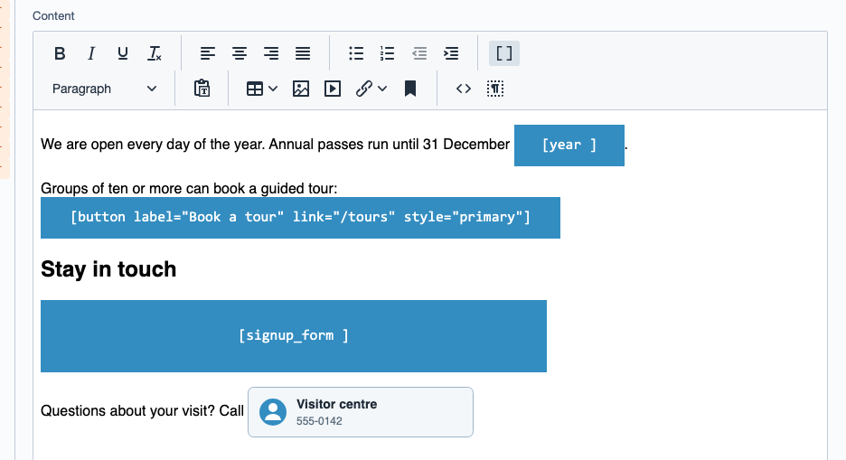
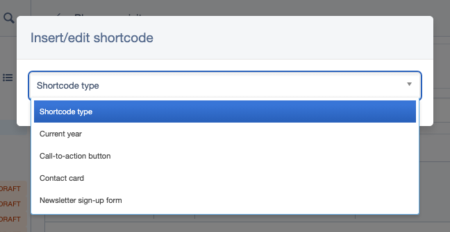
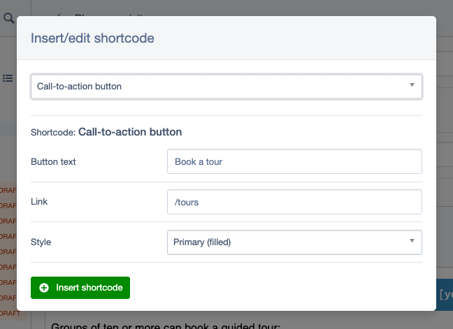

# Shortcodable: a shortcode button for the Silverstripe editor

Give CMS editors a button for shortcodes in the WYSIWYG editor: they pick a shortcode from a list,
fill in its form, and see it in their content as a placeholder image instead of bracketed code.
Selecting a placeholder and clicking the button again edits it. Developers make any class or
DataObject shortcodable with a line of YAML and a parser method. For Silverstripe 5 and 6.



*Maintained by [Restruct](https://github.com/restruct). If this module saves you time, you can
[support ongoing maintenance](https://github.com/sponsors/restruct).*

## Out of the box, editors have to type shortcodes by hand

Silverstripe's shortcode parser lets a developer register tags like `[year]` or
`[button label="Book a tour" link="/tours"]` and render them on the page. Editors get no help with
them: they have to know which shortcodes exist, remember each one's attributes and type them
exactly. In the editor a shortcode is plain bracketed text, and a typo is not caught: by default
the parser leaves an unknown shortcode in the page as it is.

This module turns registered shortcodes into something editors can find and use:

- **A toolbar button** in the HTMLEditorField that opens a dialog listing every shortcode you
  registered, by a readable label
- **A form per shortcode**: the attribute fields you define, and for a DataObject a dropdown of its
  records
- **Placeholder images in the editor** in place of the bracketed code: a generated default, or your
  own image per shortcode
- **Editing**: select a placeholder and click the button, and the dialog opens with its values filled in
- **Block-level shortcodes**: output such as a form or a gallery can close the paragraph around it,
  so the page's HTML stays valid

This module is a partial-to-largely rewrite of
[sheadawson/silverstripe-shortcodable](https://github.com/sheadawson/silverstripe-shortcodable). It
depends on [Silverstripe Simpler](https://github.com/restruct/silverstripe-simpler) for some
non-React UI functionality (mainly the modal dialog).

## Insert, see and edit shortcodes in the editor

### Picking a shortcode

The shortcode button sits in the editor toolbar (the `[ ]` icon, "Insert/edit shortcode"). It opens
a dialog with a dropdown of the registered shortcodes:



Choosing one loads that shortcode's form: the fields its class defines, and for a DataObject a
dropdown of its records. "Insert shortcode" puts the shortcode at the cursor, or in place of the
selected text; the insert can be undone like any other edit.

### Editing a shortcode that is already there

Click a placeholder to select it, then click the shortcode button. The dialog opens on that
shortcode, with its attributes in the form:



Inserting replaces the selected shortcode with the edited one. Placeholders are only an editor
view: when the page is saved, every placeholder is turned back into its shortcode text, so the
database holds `[button label="Book a tour" link="/tours" style="primary"]`, not an image.

### Placeholders

Every registered shortcode gets a placeholder in the editor. Without anything else, that is a
generated SVG showing the shortcode itself (the blue images above). A class can draw its own, like
the contact card above, with `getShortcodePlaceHolder()`; see
[Shortcode placeholder images](#shortcode-placeholder-images).

### Block-level shortcodes

Output such as a form, a video or a gallery is block-level HTML, which may not sit inside a `<p>`.
Set `shortcode_close_parent` on the class and the paragraph around the shortcode is closed before
its output and reopened after it; see [Wrapping](#wrapping-block-level-output) for the exact rules.

## Making a class shortcodable

### Register it

Register DataObjects or other classes as shortcodable via YAML config:

```yml
---
name: my_shortcodables
Only:
    classexists: Shortcodable\Shortcodable
---
Shortcodable\Shortcodable:
    shortcodable_classes:
        - My\Namespaced\Shortcodes\CurrentYearShortcode
        - My\Namespaced\Shortcodes\SomeOtherShortcode
```

Register through YAML, not programmatically in a `_config.php`: the module's own `_config.php`
reads this list to register the shortcodes with the parser and to tell the editor which shortcodes
have placeholders.

### Required methods on shortcodable objects/classes

Implement these methods on your shortcodable classes (they may also be added via an Extension):

**(Required) shortcode parser callback:**<br />
`public static function parse_shortcode(...)`<br />
**OR:**<br />
`public function MyCustomParser(...)` combined with:<br />
`private static $shortcode_callback = 'MyCustomParser'`<br />

**Parser method arguments:** (see [shortcode documentation](https://docs.silverstripe.org/en/6/developer_guides/extending/shortcodes/#parameter-values)) <br />
   `($attrs, $content=null, $parser=null, $shortcode, $info)`

**NOTE: the parser method gets called on a singleton object instance.**<br />
   (So there's no `$this->ID` or `$this->owner->ID` etc.)

A registered class without its parser method throws a `LogicException` when the shortcodes are
registered, so every request fails until it is fixed (up to 5.2.1 this was a fatal `E_USER_ERROR`).

A plain class (not a DataObject) needs the `Extensible` trait: the module checks methods with
`hasMethod()`, which comes from that trait (`DataObject` and `ViewableData`/`ModelData` subclasses
have it already).

**Optional:**
- `private static $shortcode` (optional, else the short class name is used, as `[ClassName]`)
- `getShortcodeLabel()` (optional nice description for in the dropdown; `singular_name()` or else
  the short class name is used as fallback)
- `getShortcodeFields()` (optional, a `FieldList` of attribute form fields for the dialog; each
  field's name becomes the attribute name)
- `getShortcodableRecords()` (optional, if applied to a DataObject: the `ID => title` map for the
  record dropdown; default is all records of the class)
- `getShortcodePlaceHolder($attributes)` (optional, see below)

A minimal shortcode:

```php
namespace My\Namespaced\Shortcodes;

use SilverStripe\Core\Config\Configurable;
use SilverStripe\Core\Extensible;
use SilverStripe\Core\Injector\Injectable;
use SilverStripe\Forms\FieldList;
use SilverStripe\Forms\TextField;

class ButtonShortcode
{
    use Configurable;
    use Extensible;
    use Injectable;

    private static $shortcode = 'button';

    public static function parse_shortcode($attrs, $content = null, $parser = null, $shortcode = null, $info = [])
    {
        return sprintf(
            '<a class="btn" href="%s">%s</a>',
            htmlspecialchars($attrs['link'] ?? '#'),
            htmlspecialchars($attrs['label'] ?? '')
        );
    }

    public function getShortcodeLabel()
    {
        return 'Call-to-action button';
    }

    public function getShortcodeFields()
    {
        return FieldList::create(
            TextField::create('label', 'Button text'),
            TextField::create('link', 'Link')
        );
    }
}
```

For a **DataObject**, the dialog adds a dropdown named `id` with its records, so the shortcode gets
an `id` attribute, eg `[contact id="3"]`. The record ID is also passed to the placeholder (below).

The dialog form can be changed from an Extension on `Shortcodable\Controllers\ShortcodableAdminController`
through the `updateShortcodeForm($form)` hook.

### Wrapping (block-level output)

In this module, `$shortcodable_is_block` and `$disable_wrapper` have been replaced with `$shortcode_close_parent`:<br>
- `private static $shortcode_close_parent` (optional, set to true if your shortcode output is a block-type html element)

If you set `$shortcode_close_parent` to true, the parent node will be closed before your shortcode output and reopened after. <br>
Eg `<p>Some [shortcode] content</p>` would become `<p>Some </p>[shortcode]<p> content</p>`;
If the shortcode sits inside inline elements (eg `<p><strong>Some [shortcode]</strong></p>`), those are closed
as well, up to the block element holding them, and reopened after the shortcode. A bare element (no attributes)
that would be left empty on either side is dropped instead.

Only elements that cannot hold block content are closed: `<p>`, `<h1>`-`<h6>`, `<pre>` and `<summary>` (plus
inline elements). Containers that can already hold block content, such as `<div>`, `<li>`, `<td>`, `<dt>`, `<dd>`,
`<address>`, `<blockquote>` and `<section>`, are left whole: `<li>[shortcode]</li>` stays a list item with the shortcode
output inside it. Inline elements inside such a container are still closed and reopened around the shortcode.
A shortcode nested inside more than 10 inline elements, or inside inline elements whose opening tags add up to more
than 8 KB, is left untouched (a guard against pathological markup).
Up to 5.1.0 a container on the same line was closed too, so `<div>[shortcode]</div>` lost its `<div>`; since 5.2.0
it is kept.

### Shortcode placeholder images

To display a nice image instead of the raw shortcode in the CMS editor, implement a
`getShortcodePlaceHolder()` method on your shortcodable object. The editor loads it as the `src` of
an ``, from `admin/shortcodable/placeholder/<shortcode>/<record ID>?sc=<the shortcode>` (CMS
access required). For a DataObject with an `id` attribute the method is called on that record,
otherwise on a singleton. It gets the shortcode's attributes, and whatever it returns is the
response:

```php
/**
* Redirect to an image OR return image data directly to be displayed as shortcode placeholder in the editor
* (getShortcodePlaceHolder gets loaded as/from the 'src' attribute of an  tag)
*
* @param array|null $attributes attribute key-value pairs of the shortcode
* @return \SilverStripe\Control\HTTPResponse
**/
public function getShortcodePlaceHolder($attributes)
{
    // Flavour one: redirect to image URL (for this example we're also including the attributes array in the URL)
    return Controller::curr()->redirect('https://www.silverstripe.org/apple-touch-icon-76x76.png?attrs='.json_encode($attributes));

    // Flavour two: return image/svg data directly (any bitmap but may also be SVG)
    // Hint: process attributes eg to show a set of image thumbnails wrapped in an SVG as gallery-placeholder
    $response = Controller::curr()->getResponse();
    $response->addHeader('Content-Type','image/svg+xml');
    $response->addHeader('Vary','Accept-Encoding');
    $response->setBody('<svg xmlns="http://www.w3.org/2000/svg" width="16" height="16" fill="currentColor" class="bi bi-code-square" viewBox="0 0 16 16">
      <path d="M14 1a1 1 0 0 1 1 1v12a1 1 0 0 1-1 1H2a1 1 0 0 1-1-1V2a1 1 0 0 1 1-1h12zM2 0a2 2 0 0 0-2 2v12a2 2 0 0 0 2 2h12a2 2 0 0 0 2-2V2a2 2 0 0 0-2-2H2z"/>
      <path d="M6.854 4.646a.5.5 0 0 1 0 .708L4.207 8l2.647 2.646a.5.5 0 0 1-.708.708l-3-3a.5.5 0 0 1 0-.708l3-3a.5.5 0 0 1 .708 0zm2.292 0a.5.5 0 0 0 0 .708L11.793 8l-2.647 2.646a.5.5 0 0 0 .708.708l3-3a.5.5 0 0 0 0-.708l-3-3a.5.5 0 0 0-.708 0z"/>
    </svg>');
    return $response;
}
```

#### Default placeholder image

Without `getShortcodePlaceHolder()`, the editor shows an SVG generated by `admin/shortcodable/placehold.img`
(CMS access required), with the shortcode as its text. It is 46 px high and as wide as the text
needs; with `shortcode_close_parent` it is 1000 x 460 px. `placeholder_settings` on the class
(`width`, `height`) overrides that size, and `default_placeholder` sets the defaults and colours
(see [Configuration options](#configuration-options)).

`placehold.img` takes `w` and `h` (a positive number of pixels, or `100%`), `bg` and `fg`
(3 or 6 hex digits, no `#`), `ff` (font family), `txtsize` and `txt`. Invalid values fall back to the
`default_placeholder` config. Sizes are capped at `full_width` x `full_height`.

## Technical

### Requirements

* Silverstripe 5 or 6 (`silverstripe/framework ^5 || ^6`)
* PHP 8.1 or newer (Silverstripe 6 itself needs 8.3)
* [restruct/silverstripe-simpler](https://github.com/restruct/silverstripe-simpler) `~0.2 || ^1`,
  installed automatically. On Silverstripe 6 that is 1.0.0 or later (0.x does not support 6); a
  fresh install gets 1.x on Silverstripe 5 as well, and a Silverstripe 5 project that already has
  simpler 0.2 or 0.3 can keep it
* **Silverstripe 6 only:** `silverstripe/htmleditor-tinymce`. TinyMCE is a separate module on Silverstripe 6
  and `silverstripe/recipe-cms` does not include it. Without it the site still boots, but there is no
  TinyMCE editor to add the shortcode button to.

### Installation

```
composer require restruct/silverstripe-shortcodable
# Silverstripe 6, if your project does not have it yet:
composer require silverstripe/htmleditor-tinymce
```

Then flush (`?flush=1`, or `sake dev/build flush=1` on Silverstripe 5 and `sake db:build --flush`
on 6), and register your shortcodes as above.

### Version compatibility

| Branch  | Module Version | Silverstripe   | PHP            |
|---------|----------------|----------------|----------------|
| `main`  | `5.x` (from `5.1.0`) | `^5 \|\| ^6` | `^8.1`   |
| `v4`    | `4.x`          | `^4 \|\| ^5`   | `^7.4 \|\| ^8.0` |

`main` is the maintained line and supports every Silverstripe version this module still targets.
Silverstripe 4 reached end of life in April 2025 and is no longer supported or tested here; projects
still on it can stay on the `4.x` tags, which remain available. The `5.0.x` tags declared Silverstripe 6
only, and could not be installed from Packagist (see [CHANGELOG.md](CHANGELOG.md)); use `^5.1`.
Upgrading from 4.x or 5.0.x: see [UPGRADING.md](UPGRADING.md).

**Note:** `composer.json` is the source of truth for exact version constraints.

### Configuration options

| Option | Default | What it does |
|--------|---------|--------------|
| `Shortcodable\Shortcodable.shortcodable_classes` | `[]` | Classes to register with the shortcode parser and offer in the dialog. |
| `Shortcodable\Shortcodable.htmleditor_names` | `[cms]` | HTMLEditor configs that get the shortcode button. Only TinyMCE configs are changed; others are skipped. |
| `Shortcodable\Controllers\ShortcodableAdminController.default_placeholder` | see below | Size, font and colours of the default SVG placeholder. |

`default_placeholder` keys and their defaults: `height` 46 (inline shortcodes), `full_width` 1000 and
`full_height` 460 (block shortcodes, and the maximum size), `width` 240 (only when `placehold.img`
is called without `w`), `font` a monospace font stack, `fontsize` 16, `fg` `ffffff` and `bg`
`338dc1` (the CMS blue).

Per shortcodable class (as `private static` or YAML on that class):

| Option | Default | What it does |
|--------|---------|--------------|
| `shortcode` | short class name | The shortcode tag, eg `currentyear` for `[currentyear]`. |
| `shortcode_callback` | `parse_shortcode` | Name of the parser method. |
| `shortcode_close_parent` | `false` | Block-level output: close the wrapping element before the shortcode and reopen it after (see [Wrapping](#wrapping-block-level-output)). Also gives the default placeholder the full size. |
| `placeholder_settings` | none | `width`/`height` overriding the default placeholder size for this shortcode. |

### Running the tests

The module cannot be tested on its own: it needs a host Silverstripe project. Require it there
through a Composer **path repository with `symlink: true`** - `/tests` is `export-ignore`, so a dist
or mirrored install contains no tests - add `"Shortcodable\\Tests\\": "vendor/restruct/silverstripe-shortcodable/tests/"`
to the host's `autoload-dev`, then:

```bash
# Silverstripe 5 (PHPUnit 9) - the path must come before flush=1
vendor/bin/phpunit vendor/restruct/silverstripe-shortcodable/tests flush=1

# Silverstripe 6 (PHPUnit 11) - a flush=1 argument is ignored, use the env var
SS_PHPUNIT_FLUSH=1 vendor/bin/phpunit vendor/restruct/silverstripe-shortcodable/tests
```

On Silverstripe 6 the host also needs `silverstripe/htmleditor-tinymce`, or the TinyMCE button test is
skipped. CI runs the suite against Silverstripe 5 and 6 on every push; see `.github/workflows/ci.yml`.

Browser tests (Playwright, against a real CMS: the button, the dialog, placeholders and what is
saved) live in `tests/browser/` and run in `.github/workflows/browser-tests.yml`. The screenshots in
this README are generated from the same harness; see
[tests/browser/screenshots/README.md](tests/browser/screenshots/README.md) to regenerate them.

### Rewrite status

Compared to sheadawson/silverstripe-shortcodable:

- [x] TinyMCE button/plugin
- [x] Shortcode form in popup dialog
- [x] Custom/configurable shortcode independent of class name
- [x] Custom/configurable shortcode parser callback methods
- [x] Inserting new & editing existing shortcode (+undo)
- [x] Re-implement DataObjects as shortcodable (incl. getShortcodableRecords etc)
- [x] Re-implement placeholders
- [x] Check/re-implement(?) [BOM fix](https://github.com/sheadawson/silverstripe-shortcodable/pull/5) and in [ShortcodeController](https://github.com/sheadawson/silverstripe-shortcodable/blob/master/src/Controller/ShortcodableController.php#L240)
- [x] Check/re-implement(?) [P/DIV wrapper fix](https://github.com/sheadawson/silverstripe-shortcodable/pull/51/files)
- [ ] Check/restore functionality for Uploadfields to load existing value
- [ ] Check/implement(?) [wrapping shortcodes](https://github.com/sheadawson/silverstripe-shortcodable/pull/73)

### Further reading

- [General shortcode documentation](https://docs.silverstripe.org/en/6/developer_guides/extending/shortcodes/)
- [Shortcodable V2 documentation](https://github.com/sheadawson/silverstripe-shortcodable/blob/e2e2f1a2fa981d56e3c8ba63808fbe05da3d20f0/README.md)
- [UPGRADING.md](UPGRADING.md) - upgrading from 4.x or 5.0.x
- [CHANGELOG.md](CHANGELOG.md) - release history

### License

See [license.md](license.md).
